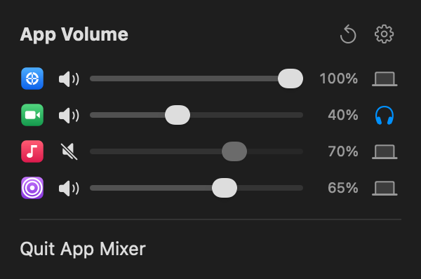
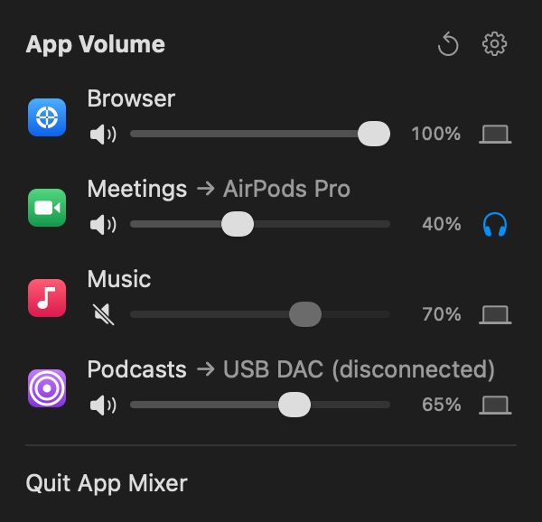

# App Mixer

Per-app volume and output routing for macOS, in the menu bar.

<!-- Screenshots: paste over the two  lines below, or replace docs/screenshots/compact.png and standard.png. -->
<p align="center">
  
  
</p>

- A volume slider and mute button for every app that uses audio, including apps that are open but silent.
- Send any app to a specific output device. If that device disconnects, the app falls back to the system output until it's back.
- Settings are remembered per app. **↺** resets everything, and the gear switches between compact and standard layouts.

Requires macOS 15 or later (Apple silicon or Intel).

## Install

Download **AppMixer.zip** from the [latest release](https://github.com/Yoyokrazy/app-mixer/releases/latest) and move **AppMixer.app** to Applications, or run:

```sh
osascript -e 'tell application id "com.yoyokrazy.AppMixer" to quit' 2>/dev/null
curl -fsSL -o /tmp/AppMixer.zip https://github.com/Yoyokrazy/app-mixer/releases/latest/download/AppMixer.zip
rm -rf /Applications/AppMixer.app && ditto -x -k /tmp/AppMixer.zip /Applications
open /Applications/AppMixer.app
```

The same commands upgrade an existing install. App Mixer has no Dock icon; it lives in the menu bar. Quitting it returns every app to its normal volume and output.

On first launch:

- **"App Mixer can't be opened":** builds aren't notarized. If you downloaded the zip in a browser, run `xattr -dr com.apple.quarantine /Applications/AppMixer.app`, or use System Settings → Privacy & Security → Open Anyway.
- **System Audio Recording:** allow it when asked; App Mixer can't change volumes without it. It's under System Settings → Privacy & Security → Screen & System Audio Recording. If it's on but volumes still don't change, run `tccutil reset AudioCapture com.yoyokrazy.AppMixer` and relaunch.
- **Asked again after upgrading?** Release builds are ad-hoc signed, so macOS sees each version as a new app. To keep the permission, sign each install with your own certificate before opening it: `codesign --force --sign "<identity>" /Applications/AppMixer.app` (list yours with `security find-identity -v -p codesigning`; a self-signed Code Signing certificate from Keychain Access works).

To start at login, add App Mixer in System Settings → General → Login Items.

### Uninstall

```sh
osascript -e 'tell application id "com.yoyokrazy.AppMixer" to quit'
rm -rf /Applications/AppMixer.app
defaults delete com.yoyokrazy.AppMixer
tccutil reset AudioCapture com.yoyokrazy.AppMixer
```

## Build from source

Needs Xcode 26 or later and [XcodeGen](https://github.com/yonaskolb/XcodeGen).

```sh
brew install xcodegen
git clone https://github.com/Yoyokrazy/app-mixer && cd app-mixer
make run
```

See [CONTRIBUTING.md](CONTRIBUTING.md) for signing, tests, and releases.

## How it works

App Mixer uses Core Audio process taps (macOS 14.2+). For each app you change, it mutes the app's audio at the source and plays it through a private aggregate device on the chosen output at the chosen volume. Apps left at 100% on the system output are never touched. The taps belong to App Mixer's process, so if it quits or crashes, macOS restores every app's audio.

## Limitations

- An app you've pointed at a specific device in its own settings (e.g. a headset in Zoom) plays on App Mixer's output instead while you've changed it here.
- The first fraction of a second of an app's very first sound can play at full volume before App Mixer picks the app up.
- Volume tops out at 100%.
- The permission check uses a private macOS framework, since there's no public API for it.
